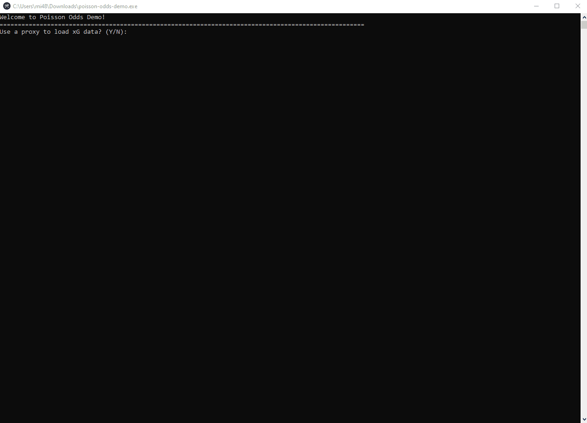
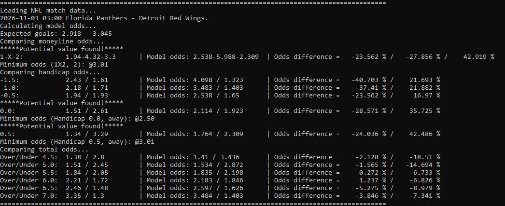

English | [Русский](README.ru.md)

<p align="center">
  
</p>

<h1 align="center">Poisson Odds Demo</h1>

<p align="center">
NHL match analysis CLI that combines expected goals (xG) statistics with Poisson-based probability modeling to 
compare estimated fair odds against bookmaker markets.
</p>

<p align="center">
  <a href="https://www.python.org/">
    
  </a>
  
  <a href="https://pypi.org/project/poisson-odds/">
    
  </a>
  
  <a href="https://github.com/nikolaitolmachev/poisson-odds-demo/actions">
    
  </a>
  
</p>

---

## CLI Demonstration

The demo shows the interactive CLI workflow, from selecting an xG estimation strategy to analyzing NHL matches and identifying potential value opportunities.



---

## Features

- **NHL data collection** — retrieves team-level expected goals (xG) statistics from Natural Stat Trick and bookmaker odds from BetExplorer.
- **Two xG estimation strategies** — supports Mean and Normalized approaches for estimating expected goals.
- **Poisson-based modeling** — uses the [poisson-odds](https://github.com/nikolaitolmachev/poisson-odds) library to calculate outcome probabilities and fair odds.
- **Value opportunity detection** — compares calculated fair odds with bookmaker prices using a configurable threshold and displays minimum acceptable odds.
- **Local caching** — reduces repeated requests and supports fallback to previously cached data when updates fail.
- **Command-line interface** — provides interactive match analysis and exports results to `stats.txt`.
- **Automated checks and Windows builds** — includes pytest, Ruff, GitHub Actions CI, and a standalone Windows executable.

---

## Tech Stack

| Component | Technologies                                           |
| --- |--------------------------------------------------------|
| **Language** | Python 3.11+                                           |
| **Data Collection** | aiohttp, requests-html, lxml                           |
| **Probability Modeling** | [poisson-odds](https://pypi.org/project/poisson-odds/) |
| **Data Storage** | JSON file caching                                      |
| **Testing** | pytest                                                 |
| **Code Quality** | Ruff                                                   |
| **CI/CD** | GitHub Actions                                         |
| **Windows Build** | PyInstaller                                            |

---

## Architecture

```text
                   Natural Stat Trick         BetExplorer
                  (NHL xG statistics)      (bookmaker odds)
                          │                       │
                          ▼                       ▼
                      xG Scraper             Odds Scraper
                          │                       │
                          ▼                       │
                     JSON Cache                   │
                          │                       │
                          ▼                       │
                  Team xG Statistics              │
                          │                       │
                          ▼                       │
                    xG Estimation                 │
                 ┌────────┴────────┐              │
                 ▼                 ▼              │
                Mean           Normalized         │
                 │                 │              │
                 └────────┬────────┘              │
                          │                       │
                          ▼                       │
                    Expected Goals                │
                          │                       │
                          ▼                       │
                     poisson-odds                 │
                   (Python library)               │
                          │                       │
                          ▼                       │
               Probabilities & Fair Odds          │
                          │                       │
                          └───────────┬───────────┘
                                      │
                                      ▼
                               Value Analysis
                           (configurable threshold)
                                      │
                                      ▼
                                 CLI Results
                                      │
                                      ▼
                                  stats.txt
```

The application separates data collection, xG estimation, probability modeling, and value analysis. 
The [poisson-odds](https://github.com/nikolaitolmachev/poisson-odds) library handles probability calculations independently of the scraping and CLI layers.

---

## How It Works

### 1. Expected Goals Estimation

The application uses NHL expected goals (xG) statistics from Natural Stat Trick to estimate each team's scoring rate.

Two estimation strategies are available:

**Mean (default)**

Calculates the average of a team's offensive xG rate and its opponent's defensive xG rate:


**Normalized**

Adjusts the team's offensive and opponent's defensive xG rates relative to the league average:


Home and away scoring rates are estimated separately using the corresponding team statistics.

### 2. Probability Modeling

The estimated scoring rates are passed to the [poisson-odds](https://github.com/nikolaitolmachev/poisson-odds) library, which calculates outcome probabilities and corresponding fair odds using the Poisson distribution.

Fair decimal odds are calculated as:


### 3. Value Opportunity Detection

The application compares model-derived fair odds with bookmaker odds from BetExplorer.

A potential value opportunity is identified when the bookmaker odds exceed the model's fair odds by at least the configured percentage threshold.

The CLI displays the bookmaker odds, calculated fair odds, and minimum acceptable bookmaker odds for each identified opportunity.

These results represent model-based estimates, not guarantees of predictive accuracy or profitability.

---

## Analysis Results

The CLI displays estimated outcome probabilities, fair odds, bookmaker odds, and potential value opportunities for NHL matches.



For each identified opportunity, the application also shows the minimum acceptable bookmaker odds based on the configured value threshold.

---

## Installation

### From Source

**Requirements:**
- Python 3.11 or newer
- Internet connection for retrieving NHL statistics and bookmaker odds

Clone the repository:

```bash
git clone https://github.com/nikolaitolmachev/poisson-odds-demo.git
cd poisson-odds-demo
```

Create and activate a virtual environment:

**Linux / macOS:**

```bash
python3 -m venv .venv
source .venv/bin/activate
```

**Windows (PowerShell):**

```powershell
py -m venv .venv
.\.venv\Scripts\Activate.ps1
```

Install the application and its dependencies:

```bash
python -m pip install .
```

Run the application:

```bash
python main.py
```

### Windows Executable

A standalone Windows executable is available as a build artifact from [GitHub Actions](https://github.com/nikolaitolmachev/poisson-odds-demo/actions).

Download the `poisson-odds-demo-windows` artifact from a successful workflow run, extract the archive, and launch `poisson-odds-demo.exe`.

Python installation is not required to run the executable.

---

## Configuration

The application can be configured using environment variables or an optional `.env` file.

| Variable | Default | Description |
| --- | --- | --- |
| `MINIMAL_MATCHES_TO_COUNT` | `3` | Minimum number of home or away matches required for xG calculations. |
| `MODEL_VALUE_DIFFERENCE` | `30` | Minimum relative difference between bookmaker odds and fair odds, expressed as a percentage. |
| `PROXY` | — | Optional HTTP or SOCKS proxy URL. |
| `STATS_FILE` | `stats.txt` | Output file for analysis results. |

For example, create a `.env` file in the project root:

```dotenv
MINIMAL_MATCHES_TO_COUNT=3
MODEL_VALUE_DIFFERENCE=30
PROXY=
STATS_FILE=stats.txt
```

For the Windows executable, place the `.env` file alongside `poisson-odds-demo.exe`.

System environment variables take precedence over values defined in `.env`. If no configuration is provided, the application uses its default settings.

---

## Development

Install the project with development dependencies:

```bash
python -m pip install -e ".[dev]"
```

### Tests and Code Quality

Run the test suite:

```bash
python -m pytest -q
```

Check code quality and formatting:

```bash
python -m ruff check .
python -m ruff format --check .
```

GitHub Actions automatically runs these checks on pushes and pull requests.

### Windows Executable Build

To build a standalone Windows executable locally, run `build.bat` on Windows.

The script installs the required build dependencies, packages the application using PyInstaller, and saves the executable to:

```text
dist/poisson-odds-demo.exe
```

The build process does not require an existing Python virtual environment in the project directory.

GitHub Actions also builds the Windows executable and publishes it as a downloadable workflow artifact.

---

## Limitations

- **Model assumptions** — the Poisson model assumes independent goal-scoring processes and does not directly account for injuries, starting goaltenders, lineup changes, or other contextual factors.
- **Data availability** — NHL statistics and bookmaker odds depend on third-party websites. Changes to their structure or temporary outages may affect data collection.
- **Prediction accuracy** — xG-based estimates are subject to uncertainty and have not been validated as a consistently profitable betting strategy.
- **Value opportunities** — identified opportunities reflect differences between model estimates and bookmaker odds, not guaranteed profitable outcomes.

This project is intended for educational and analytical purposes.

---

## License

This project is licensed under the MIT License. See [LICENSE](LICENSE) for details.
