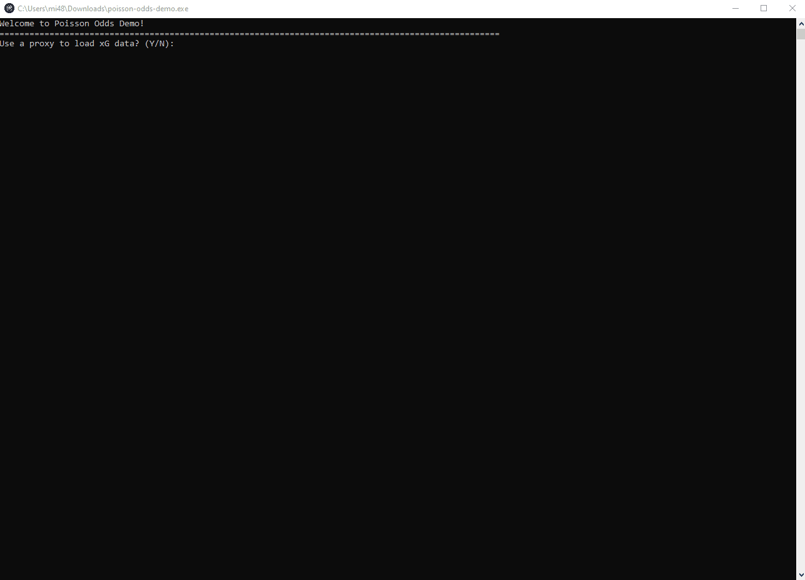
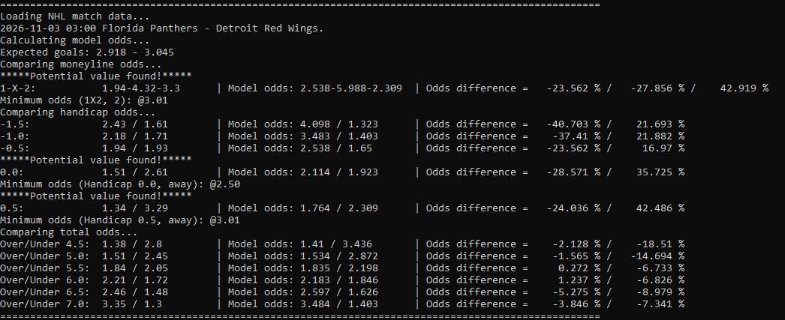

[English](README.md) | Русский

<p align="center">
  
</p>

<h1 align="center">Poisson Odds Demo</h1>

<p align="center">
Консольное приложение для анализа матчей НХЛ, объединяющее статистику ожидаемых голов (xG)
и вероятностную модель Пуассона для расчёта справедливых коэффициентов и их сравнения
с коэффициентами букмекеров.
</p>

<p align="center">
  <a href="https://www.python.org/">
    
  </a>
  
  <a href="https://pypi.org/project/poisson-odds/">
    
  </a>
  
  <a href="https://github.com/nikolaitolmachev/poisson-odds-demo/actions">
    
  </a>
  
</p>

---

## Демонстрация работы

На демонстрации показан процесс работы с приложением: от выбора способа расчёта ожидаемых голов (xG) до анализа матчей НХЛ и выявления потенциально выгодных букмекерских коэффициентов.



---

## Возможности

- **Сбор данных НХЛ** — получение статистики ожидаемых голов (xG) команд с Natural Stat Trick и букмекерских коэффициентов с BetExplorer.
- **Два способа оценки ожидаемых голов** — поддержка стратегий Mean и Normalized.
- **Моделирование на основе распределения Пуассона** — использование библиотеки [poisson-odds](https://github.com/nikolaitolmachev/poisson-odds) для расчёта вероятностей исходов и справедливых коэффициентов.
- **Поиск потенциально выгодных коэффициентов** — сравнение справедливых коэффициентов с букмекерскими с учётом настраиваемого порога и отображение минимально приемлемых коэффициентов.
- **Локальное кеширование** — сокращение повторных запросов и возможность использовать ранее сохранённые данные при ошибках обновления.
- **Консольный интерфейс** — интерактивный анализ матчей и сохранение результатов в `stats.txt`.
- **Автоматические проверки и сборка для Windows** — тестирование с помощью pytest, проверка кода Ruff, автоматизация через GitHub Actions и создание самостоятельного исполняемого файла для Windows.

---

## Используемые технологии

| Компонент | Технологии                                             |
| --- |--------------------------------------------------------|
| **Язык программирования** | Python 3.11+                                           |
| **Сбор данных** | aiohttp, requests-html, lxml                           |
| **Расчёт вероятностей** | [poisson-odds](https://pypi.org/project/poisson-odds/) |
| **Хранение данных** | Кеширование в JSON-файлах                              |
| **Тестирование** | pytest                                                 |
| **Проверка качества кода** | Ruff                                                   |
| **Автоматизация проверок и сборки** | GitHub Actions                                         |
| **Сборка приложения для Windows** | PyInstaller                                            |

---

## Архитектура

```text
                  Natural Stat Trick          BetExplorer
                   (статистика xG)       (коэффициенты букмекеров)
                         │                        │
                         ▼                        ▼
                   Сбор xG-данных          Сбор коэффициентов
                         │                        │
                         ▼                        │
                      JSON-кеш                    │
                         │                        │
                         ▼                        │
                 Статистика xG команд             │
                         │                        │
                         ▼                        │
                      Оценка xG                   │
                 ┌───────┴────────┐               │
                 ▼                ▼               │
                Mean          Normalized          │
                 │                │               │
                 └───────┬────────┘               │
                         │                        │
                         ▼                        │
                   Ожидаемые голы                 │
                         │                        │
                         ▼                        │
                     poisson-odds                 │
                  (библиотека Python)             │
                         │                        │
                         ▼                        │
                Вероятности и справедливые        │
                     коэффициенты                 │
                         │                        │
                         └───────────┬────────────┘
                                     │
                                     ▼
                               Поиск выгодных
                                коэффициентов
                            (настраиваемый порог)
                                     │
                                     ▼
                              Результаты анализа
                                     │
                                     ▼
                                 stats.txt
```

В приложении разделены сбор данных, оценка ожидаемых голов (xG), расчёт вероятностей и поиск потенциально выгодных коэффициентов.

Библиотека [poisson-odds](https://github.com/nikolaitolmachev/poisson-odds) выполняет расчёты вероятностей независимо от компонентов сбора данных и консольного интерфейса.

---

## Как это работает

### 1. Оценка ожидаемых голов

Приложение использует статистику ожидаемых голов (xG) команд НХЛ с Natural Stat Trick для оценки результативности каждой команды.

Доступны два способа расчёта:

**Mean (по умолчанию)**

Вычисляет среднее арифметическое между показателем ожидаемых забитых голов команды и показателем ожидаемых пропущенных голов её соперника:


**Normalized**

Учитывает показатели ожидаемых забитых голов команды и ожидаемых пропущенных голов соперника относительно среднего значения по лиге:


Ожидаемое количество голов хозяев и гостей рассчитывается отдельно с использованием соответствующей статистики команд.

### 2. Расчёт вероятностей

Рассчитанные показатели ожидаемых голов передаются в библиотеку [poisson-odds](https://github.com/nikolaitolmachev/poisson-odds), которая использует распределение Пуассона для вычисления вероятностей исходов и соответствующих справедливых коэффициентов.

Справедливые коэффициенты в десятичном формате рассчитываются по формуле:


### 3. Поиск потенциально выгодных коэффициентов

Приложение сравнивает справедливые коэффициенты, рассчитанные моделью, с букмекерскими коэффициентами, полученными с BetExplorer.

Потенциально выгодный коэффициент определяется, если букмекерский коэффициент превышает справедливый коэффициент модели не менее чем на заданный процент.

Для каждого найденного варианта консольный интерфейс отображает букмекерский коэффициент, рассчитанный справедливый коэффициент и минимально приемлемый букмекерский коэффициент.

Полученные результаты представляют собой оценки математической модели и не гарантируют точность прогнозов или прибыльность ставок.

---

## Результаты анализа

Консольное приложение отображает рассчитанные вероятности исходов матчей НХЛ, справедливые и букмекерские коэффициенты, а также выявленные потенциально выгодные варианты.



Для каждого найденного варианта приложение также показывает минимально приемлемый букмекерский коэффициент с учётом заданного порога.

---

## Установка

### Запуск из исходного кода

**Требования:**
- Python 3.11 или новее
- Подключение к интернету для получения статистики НХЛ и букмекерских коэффициентов

Клонируйте репозиторий:

```bash
git clone https://github.com/nikolaitolmachev/poisson-odds-demo.git
cd poisson-odds-demo
```

Создайте и активируйте виртуальное окружение:

**Linux / macOS:**

```bash
python3 -m venv .venv
source .venv/bin/activate
```

**Windows (PowerShell):**

```powershell
py -m venv .venv
.\.venv\Scripts\Activate.ps1
```

Установите приложение и его зависимости:

```bash
python -m pip install .
```

Запустите приложение:

```bash
python main.py
```

### Исполняемый файл для Windows

Готовый исполняемый файл для Windows доступен среди артефактов сборки в [GitHub Actions](https://github.com/nikolaitolmachev/poisson-odds-demo/actions).

Скачайте артефакт `poisson-odds-demo-windows` из успешно завершённого процесса сборки, распакуйте архив и запустите `poisson-odds-demo.exe`.

Для запуска исполняемого файла установка Python не требуется.

---

## Настройка

Приложение можно настроить с помощью переменных окружения или необязательного файла `.env`.

| Переменная | По умолчанию | Описание |
| --- | --- | --- |
| `MINIMAL_MATCHES_TO_COUNT` | `3` | Минимальное количество домашних или выездных матчей, необходимое для расчёта xG. |
| `MODEL_VALUE_DIFFERENCE` | `30` | Минимальное превышение букмекерского коэффициента над справедливым, выраженное в процентах. |
| `PROXY` | — | Необязательный адрес прокси-сервера HTTP или SOCKS. |
| `STATS_FILE` | `stats.txt` | Файл для сохранения результатов анализа. |

Например, создайте файл `.env` в корневом каталоге проекта:

```dotenv
MINIMAL_MATCHES_TO_COUNT=3
MODEL_VALUE_DIFFERENCE=30
PROXY=
STATS_FILE=stats.txt
```

При использовании исполняемого файла для Windows разместите `.env` в одном каталоге с `poisson-odds-demo.exe`.

Системные переменные окружения имеют приоритет над значениями из `.env`. Если настройки не заданы, приложение использует значения по умолчанию.

---

## Разработка

Установите проект с зависимостями для разработки:

```bash
python -m pip install -e ".[dev]"
```

### Тестирование и качество кода

Запустите тесты:

```bash
python -m pytest -q
```

Проверьте качество кода и соблюдение правил форматирования:

```bash
python -m ruff check .
python -m ruff format --check .
```

GitHub Actions автоматически выполняет эти проверки при отправке изменений в репозиторий и создании запросов на слияние (pull requests).

### Сборка исполняемого файла для Windows

Для локальной сборки самостоятельного исполняемого файла Windows запустите `build.bat`.

Скрипт устанавливает необходимые зависимости для сборки, создаёт исполняемый файл с помощью PyInstaller и сохраняет его по пути:

```text
dist/poisson-odds-demo.exe
```

Для сборки не требуется заранее создавать виртуальное окружение Python в каталоге проекта.

GitHub Actions также автоматически собирает исполняемый файл для Windows и предоставляет его для скачивания в виде артефакта сборки.

---

## Ограничения

- **Допущения модели** — модель Пуассона предполагает независимость процессов забивания голов командами и не учитывает напрямую травмы игроков, выбор стартовых вратарей, изменения в составах и другие факторы, влияющие на ход матча.
- **Доступность данных** — статистика НХЛ и букмекерские коэффициенты поступают со сторонних сайтов. Изменения в их структуре или временная недоступность могут повлиять на сбор данных.
- **Точность прогнозов** — оценки на основе xG содержат неопределённость, а эффективность модели в качестве стабильно прибыльной стратегии ставок не подтверждена.
- **Потенциально выгодные коэффициенты** — найденные варианты отражают расхождения между оценками модели и букмекерскими коэффициентами, но не гарантируют получение прибыли.

Проект предназначен для образовательных и аналитических целей.

---

## Лицензия

Проект распространяется по лицензии MIT. Подробнее — в файле [LICENSE](LICENSE).
